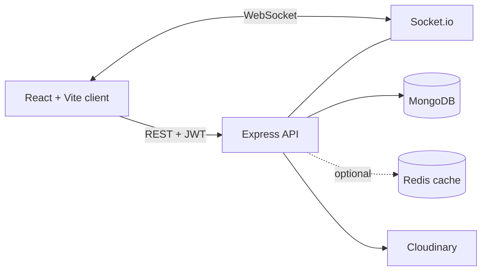

# Alumni Network Portal

A full-stack (MERN) platform that connects alumni and students for networking, mentorship, job referrals, and real-time chat, with an admin dashboard for moderation.

[](https://github.com/lenin-12/Alumni/actions/workflows/ci.yml)

**Live demo:** (https://alumni-weld-eight.vercel.app/)
**Screenshots:** 

---

## Features

- **Authentication:** email/password or Google OAuth, with short-lived access tokens and refresh tokens.
- **Role-based access control:** three roles (`STUDENT`, `ALUMNI`, `ADMIN`). Admin-only routes are guarded on the server.
- **Profiles:** work experience, achievements and recognitions, and public/private profile visibility.
- **Networking:** connection requests between alumni and students, plus an alumni directory with search.
- **Real-time chat:** direct and group chat over Socket.io with persistent history and search.
- **Community boards:** job referrals, events, a photo gallery, and a points-based leaderboard.
- **Admin dashboard:** manage users and roles, verify achievements, moderate jobs and gallery content, and handle contact submissions.

---

## Engineering Highlights

This project goes beyond CRUD. The backend includes production-minded work:

| Area | What was done |
|------|---------------|
| **Query performance** | Added compound indexes and measured them with MongoDB `explain()`. Example: the achievements feed dropped from 18ms to 1ms and the alumni directory query from 16ms to 0ms (1,000 users, 10,000 jobs seeded). See [`backend/BENCHMARKS.md`](backend/BENCHMARKS.md). |
| **Caching** | Redis cache for hot reads (leaderboard, alumni, jobs, events, gallery) using versioned keys, TTL jitter, and single-flight protection. It fails open: if Redis is down or not configured, requests fall through to MongoDB. See [`backend/CACHING.md`](backend/CACHING.md). |
| **Error handling** | Centralized error middleware with a custom `AppError` class. Mongo duplicate keys map to 409, invalid IDs to 400, and expired JWTs to 401. |
| **Validation** | Request bodies validated with Zod schemas before reaching controllers. |
| **Rate limiting** | Sliding-window limiter on auth endpoints (login, register, token refresh). |
| **Health checks** | `/health` (liveness), `/health/ready` (DB readiness), `/health/cache` (hit rate). |
| **Testing and CI** | Unit and HTTP tests, plus integration tests against a real MongoDB (auth, RBAC, ownership). A GitHub Actions workflow runs them on every pull request, with a `mongo:7` service container. |

---

## Tech Stack

| Layer | Technologies |
|-------|--------------|
| Frontend | React 18, Vite, Tailwind CSS, React Router, Axios, Framer Motion, Socket.io client |
| Backend | Node.js, Express 5, Mongoose, Socket.io, Zod |
| Database and cache | MongoDB, Redis (optional) |
| Auth | JWT (access and refresh), bcrypt, Google OAuth |
| Media | Cloudinary, Multer |
| DevOps | GitHub Actions |

---

## Architecture



```
Alumni/
├── frontend/                 # React + Vite client
└── backend/
    ├── server.js             # Entry point (HTTP + Socket.io)
    ├── src/
    │   ├── app.js            # Express app and route mounting
    │   ├── controllers/      # Request handlers
    │   ├── routes/           # API routes
    │   ├── middleware/       # Auth, RBAC, error handling, validation
    │   ├── models/           # Mongoose models
    │   ├── schemas/          # Zod validation schemas
    │   ├── utils/            # Cache, pagination, tokens, errors
    │   └── config/           # Redis setup
    ├── scripts/              # Seed admin, index sync, benchmarks
    └── tests/                # Unit, HTTP, and DB integration tests
```

---

## API Overview

| Area | Base path |
|------|-----------|
| Auth | `/api/auth` (register, login, Google login, refresh, forgot password) |
| Users and admin | `/api/users` |
| Alumni directory | `/api/alumni` |
| Connections | `/api/connections` |
| Chat | `/api/chat`, `/api/searchchat` |
| Jobs, events, gallery | `/api/jobs`, `/api/events`, `/api/gallery` |
| Profile sections | `/api/work-experience`, `/api/achievements` |
| Contact and email | `/api/contact`, `/api/email` |
| Health | `/health`, `/health/ready`, `/health/cache` |

Protected routes need an `Authorization: Bearer <token>` header. Admin routes additionally require the `ADMIN` role.

---

## Getting Started

### Prerequisites

- Node.js 22+
- MongoDB (local or Atlas)
- Cloudinary account (media uploads)
- Google OAuth client ID (for Google sign-in)
- Redis (optional, enables caching)

### 1. Clone

```bash
git clone https://github.com/lenin-12/Alumni.git
cd Alumni
```

### 2. Backend

```bash
cd backend
cp .env.example .env      # then fill in the values
npm install
node scripts/seedAdmin.js # optional: create an admin account
npm run dev               # http://localhost:5001
```

| Variable | Purpose |
|----------|---------|
| `PORT` | API port (default 5001) |
| `MONGO_URI` | MongoDB connection string |
| `JWT_ACCESS_SECRET`, `JWT_REFRESH_SECRET` | Signing keys for access and refresh tokens |
| `FRONTEND_URL` | Allowed frontend origin (CORS) |
| `GOOGLE_CLIENT_ID` | Google OAuth verification |
| `CLOUDINARY_CLOUD_NAME`, `CLOUDINARY_API_KEY`, `CLOUDINARY_API_SECRET` | Media uploads |
| `REDIS_URL`, `REDIS_PREFIX` | Optional. Leave unset to run without caching |

### 3. Frontend

```bash
cd frontend
npm install
npm run dev               # http://localhost:5173
```

Create `frontend/.env`:

```env
VITE_API_URL=http://localhost:5001
VITE_GOOGLE_CLIENT_ID=your_google_client_id
```

---

## Testing

```bash
cd backend
npm run test:nodb   # unit and HTTP tests (no database needed)
npm run test:db     # integration tests (needs MongoDB running)
```

CI runs both suites on every pull request and every push to `main`.

---

## Deployment

- **Frontend:** Vercel or Netlify. Build command `npm run build`, output directory `dist`, and set `VITE_API_URL` to your backend URL.
- **Backend:** Render, Railway, or similar. Start command `npm start`, with all backend environment variables configured.
- **Production note:** Mongoose `autoIndex` is disabled in production. After deploying, run `NODE_ENV=production node scripts/syncIndexes.js` once to build indexes.

---

## Author

**Lenin** — [GitHub](https://github.com/lenin-12)
